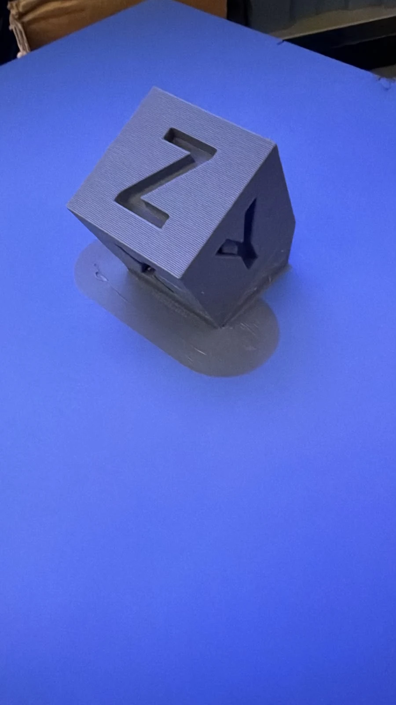
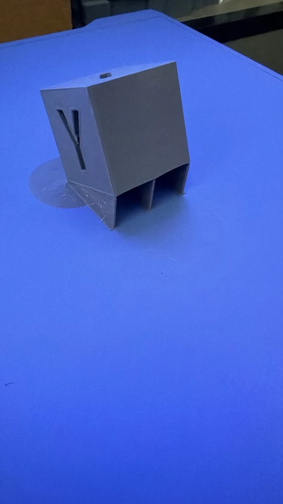
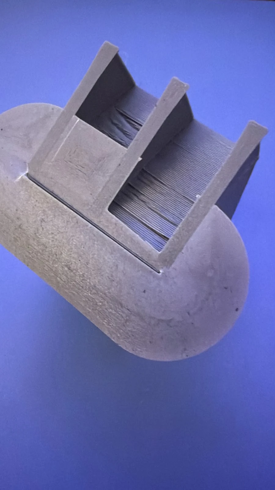
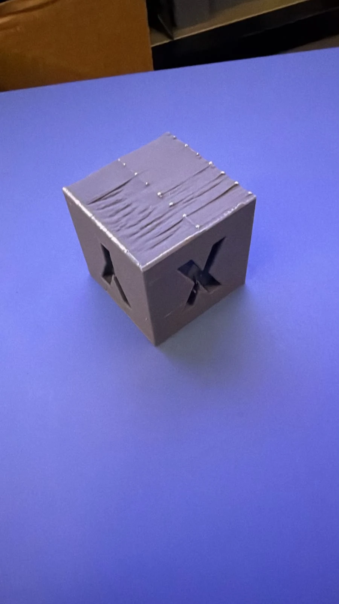

# Chapter 2: Support Fins on macOS

> Read the [overview](00-Overview.md) and the [Linux chapter](01-Linux.md) first.
> The steps are the same; this chapter records what differs on the Mac.
> Status: **completed on 13 Oct 2026: same result as Linux** ✅.

## Test environment

| Item | Value |
|---|---|
| macOS / version | macOS 27.0.1 (build 26A434), Mac mini |
| Chip | Apple Silicon (`arm64`) |
| Stable OrcaSlicer installed | **none on this Mac mini** (nothing in `/Applications/Orca*`, no `~/Library/Application Support/OrcaSlicer`) |
| Nightly tested | **2.5.0-dev** (`CFBundleShortVersionString`), `.dmg` of 13 Oct 2026 17:52 UTC, sha256 `7fcc7776…09ba` |
| Plugin version / sha256 | 0.1.0 / `65df17fa…963f`, the same file as on Linux |
| Printer profile | Creality K2 Pro 0.4 nozzle |

## What differs from Linux

| | Linux | macOS |
|---|---|---|
| Configuration folder | `~/.config/OrcaSlicer` | `~/Library/Application Support/OrcaSlicer` |
| Nightly | AppImage | `.dmg`; the app has to be **renamed** (see step 1) |
| Gatekeeper | n/a | the nightly is unsigned; the quarantine flag may need clearing |
| `mini-racer` | linux-x64 wheel | macOS arm64 or x64 wheel, picked automatically by `uv` |
| **Plugins** menu | inside the window | in the system menu bar |
| Scripts | same | same (they detect the OS) |

## Step 0: prepare the working folder

```bash
mkdir -p ~/Projects/Orcaslicer/{apps,backups,downloads}
cd ~/Projects/Orcaslicer
git clone https://github.com/jglerner/OrcaSlicer_Plugin_Lab.git
```

## Step 1: install the nightly WITHOUT replacing a stable install

1. From <https://github.com/OrcaSlicer/OrcaSlicer/releases/tag/nightly-builds>, download **`OrcaSlicer_Mac_universal_nightly.dmg`** (universal: Apple Silicon and Intel) into `~/Projects/Orcaslicer/apps/`. **Not** `OrcaSlicer_profile_validator_Mac_universal_nightly.dmg`, which is a utility. Check the sha256 with `shasum -a 256` against the page.
2. Copy the app out of the `.dmg` under a **different name**, so it never replaces an `OrcaSlicer.app` in `/Applications`:
   ```bash
   cd ~/Projects/Orcaslicer/apps
   hdiutil attach OrcaSlicer_Mac_universal_nightly-YYYYMMDD.dmg -nobrowse -mountpoint /tmp/orca-dmg
   cp -R /tmp/orca-dmg/OrcaSlicer.app ~/Projects/Orcaslicer/apps/OrcaSlicer-Nightly.app
   hdiutil detach /tmp/orca-dmg
   ```
   (On macOS 27 `hdiutil` warns it is deprecated; the suggested replacement is
   `diskutil image attach --mountOptions nobrowse --mountPoint /tmp/orca-dmg <file>.dmg` and `diskutil eject /tmp/orca-dmg`.)
3. Clear the quarantine flag:
   ```bash
   xattr -dr com.apple.quarantine ~/Projects/Orcaslicer/apps/OrcaSlicer-Nightly.app
   ```
   (or System Settings ▸ Privacy & Security ▸ **Open Anyway**).

## Step 2: open once, then close

**On a Mac that has never run Orca**, the configuration folder does not exist yet and the install
script needs it. Open the nightly once, go through the setup wizard (K2 Pro 0.4 nozzle, Generic
PLA), and quit with **⌘Q**.

⚠️ **Do not use the green button (full screen).** On this Mac it froze the whole system (see the log).

## Linux reference (what to compare against)

| Item | Linux (reference) |
|---|---|
| Nightly | 2.5.0, build of 13 Oct 2026 |
| Plugin | 0.1.0, sha256 `65df17faabfbd870918b3f0fdc95e460229241afb996e2fb8ab830871706963f` (copy in `plugins/support-fins/`) |
| Project | tilted `xyzCalibration_cube` + 0.20mm Standard profile + Support Fins + 5 mm brim + 6 % infill (`.3mf` from Linux) |
| Engine log | `4 walls, 24 tines; 3 overhangs are too shallow…`, `overhangRegions: 5`, `padTriangles: 35904`, `layers_touched: 141` |
| Slice | 267 layers of 0.20 mm, estimate 49 min 19 s, 21.56 g |
| Print | 49 min 49 s, 7.39 m; fins come off by hand; scar on the supported face |

**"No difference" criterion:** with the same `.3mf` and the same sha256, the Mac's
`support_fins_log.jsonl` must repeat `4 walls, 24 tines`, `layers_touched: 141` and the same area
per layer, and Orca must estimate the same time and weight.

## Step 3: backup + plugin install (one command)

With Orca closed (⌘Q):

```bash
cd ~/Projects/Orcaslicer/OrcaSlicer_Plugin_Lab
git pull
PLUGIN_FILE=plugins/support-fins/support_fins_orca-65df17fa.py scripts/install-support-fins.sh
```

This installs **the same copy** used on Linux instead of downloading `plugins-latest`, which may
have changed. The sha256 printed at the end must be `65df17fa…963f`.

## Steps 4 to 6: same as Linux

Follow steps 3 to 5 of [Chapter 1](01-Linux.md#step-3-activate-the-plugin), with these Mac specifics:

- **Plugins** is in the **system menu bar** at the top of the screen.
- The process panel opens in **simple mode** after a fresh install (no Speed tab; Others shows only
  Skirt, Brim, Special mode and Fuzzy skin). Turn on the **Advanced** toggle next to *Global / Objects*;
  only then does *Others ▸ Slicing Pipeline Plugin* appear.
- **Orca Cloud:** don't log in in the nightly. A synced profile that references Support Fins would
  refuse to slice on an install without the plugin ("missing plugin").
- **Pressure Advance:** check that *Enable pressure advance* is **off** in the filament profile
  (pencil icon ▸ Advanced). PA comes from the printer's `printer.cfg` (see the overview).

## Step 7: record results

```bash
cd ~/Projects/Orcaslicer/OrcaSlicer_Plugin_Lab
scripts/collect-logs.sh "part, 0.20mm, PLA"
git add logs/macos && git commit -m "macOS: Support Fins test" && git push
```

Live:

```bash
tail -f ~/Library/Application\ Support/OrcaSlicer/log/python_*.log
```

### Checklist (same numbering as Linux)

| # | Check | Result | Same as Linux? |
|---|---|---|---|
| 1 | Nightly opens and shows the **Plugins** menu | ✅ 2.5.0-dev | ⚠️ no: first launch froze the Mac in full screen (reboot) |
| 2 | Plugin listed with version 0.1.0 | ✅ | yes (menu in the system menu bar) |
| 3 | Activation installs `numpy` + `mini-racer` without errors | ✅ (arm64) | yes |
| 4 | "Slicing Pipeline Plugin" shows in the profile (Advanced ▸ Others) | ✅ | yes (Advanced mode only) |
| 5 | Permission prompts appear and are accepted | ➖ none appeared | same as Linux |
| 6 | Fins visible in Preview | ✅ | yes |
| 7 | `.jsonl` log matches Linux for the same part and profile | ✅ `4 walls, 24 tines`, 141 layers | **identical**, layer by layer |
| 8 | Part with **Enable support ON** is skipped | ➖ not tested | not tested on Linux either |
| 9 | Rotate the part + re-slice → fins follow | ➖ not tested | |
| 10 | G-code sent to the K2 Pro and printed | ✅ 50 min 31 s, 7.28 m | yes (smaller purge) |
| 11 | First layer of the pad OK | ✅ | yes |
| 12 | Fins break away cleanly | ⚠️ | yes: same scar on the supported face |
| 13 | Stable release still opens normally | ➖ | no stable release on this Mac |

## Rolling back

```bash
rm -rf ~/Library/Application\ Support/OrcaSlicer/orca_plugins/SupportFins
# restore the whole configuration (with Orca closed)
mv ~/Library/Application\ Support/OrcaSlicer ~/Library/Application\ Support/OrcaSlicer.nightly-test
tar -xzf ~/Projects/Orcaslicer/backups/OrcaSlicer-<date>.tar.gz -C ~/Library/Application\ Support
```

## Opening the nightly day to day (macOS)

- **From Finder or the Dock:** open `~/Projects/Orcaslicer/apps/` and double-click `OrcaSlicer-Nightly.app`.
  Drag it to the Dock to keep it handy. Spotlight also finds "OrcaSlicer-Nightly".
- **From Terminal**, to see live messages while investigating a problem:
  ```bash
  ~/Projects/Orcaslicer/apps/OrcaSlicer-Nightly.app/Contents/MacOS/OrcaSlicer 2>&1 | tee ~/Projects/Orcaslicer/nightly-mac-run.log
  ```
- ⚠️ **Never use the green button (full screen)** with the nightly on this Mac: that is what froze the system.
- Always quit with **⌘Q**. If macOS reopens Orca by itself after a restart, that is just window restoration.
- Screenshots: if ⇧⌘3 / ⇧⌘4 don't work (e.g. a Bluetooth keyboard in Windows mode), use
  `screencapture -T 5 ~/Desktop/orca.png` from Terminal.

## Log

### 2026-10-13 16:44–16:56: surveying the Mac

- Mac mini, macOS 27.0.1, Apple Silicon (`arm64`).
- `~/Projects/Orcaslicer/{apps,backups,downloads}` created and the repository cloned into
  `~/Projects/Orcaslicer/OrcaSlicer_Plugin_Lab` (branch `claude/sweet-ritchie-ogkhg8`).
- **No OrcaSlicer installed** and **no configuration folder**: Orca had never run on this Mac. Consequences:
  - no profiles to protect, so the backup is a formality;
  - the order of steps changes: **open the nightly once** (to create the configuration and pick
    the K2 Pro 0.4 in the wizard), **quit**, and only then run `install-support-fins.sh`, which
    requires the configuration folder to exist.
- Note: in zsh (the macOS default shell) a glob with no match aborts the whole line
  (`zsh: no matches found`), and `[o]rca` must be quoted (`grep -i '[o]rca'`).
- **Decision:** with no other Orca on this Mac, the **nightly is the only install**. It still lives in
  `~/Projects/Orcaslicer/apps/OrcaSlicer-Nightly.app`, to keep the same layout as Linux and leave the
  `OrcaSlicer.app` name in `/Applications` free for a future stable release.

### 2026-10-13: downloading the nightly

- `~/Projects/Orcaslicer/apps/OrcaSlicer_Mac_universal_nightly-20261013.dmg`, 379,451,701 bytes.
- sha256 `7fcc77764331d08f4f3638205bf094522ab741f2ca26b8ddce07118b504c09ba`, confirmed by a second,
  independent download (same hash).
- ⚠️ **Not the same nightly build as on Linux.** The `.dmg` was republished at 17:52 UTC, after the
  asset list copied that morning (which showed `43ff09ad…` and 363 MB), so there was at least one new
  build that day. For the comparison this means two different Orca builds. What must be identical is
  the **plugin** (sha256) and the **project**; if results diverge, the Orca build is the first suspect.

### 2026-10-13: app copied as `OrcaSlicer-Nightly.app`

- The `.dmg` contains `OrcaSlicer.app` and an `Applications` shortcut. The `.dmg`'s internal checksums verified.
- Copied to `~/Projects/Orcaslicer/apps/OrcaSlicer-Nightly.app`, quarantine cleared (`xattr -dr`).
- `hdiutil attach/detach` works on macOS 27 but warns it is *deprecated* (replacement noted in step 1).
- App version: **2.5.0-dev**, the same 2.5.0 series as on Linux.

### 2026-10-13: setup wizard and comparison conditions

- Wizard: **Stealth Mode on** (it only disables cloud features; local plugins and `uv` are
  unaffected, checked in the Orca source), **Bambu Network Plugin not installed** (useless for the K2
  Pro), **no Orca Cloud login**.
- **Same conditions as Linux ("apples to apples"):** same part and pose, profile
  `0.20mm Standard @Creality K2 Pro 0.4 nozzle`, Generic PLA at **220 °C** (Linux was also 220 °C;
  the 240 °C seen at the start is the CFS purge), bed 50 °C, **6 % infill**, **Auto brim 5 mm**,
  Support Fins with the default config. The only variable is the OS (and, unintentionally, the
  nightly build).
- Temperature tower comes **after** the comparison.

### 2026-10-13 17:10–17:26: ⚠️ first launch froze the Mac (forced reboot)

- The nightly was opened with `open`. The wizard completed (K2 Pro 0.4; configuration in
  `~/Library/Application Support/OrcaSlicer` created at 17:10–17:13). Around 17:18 the window was put in
  **full screen** (green button) and the screen froze, covering even the menu bar and Dock. ⌘Tab and
  ⌥⌘Esc did not help: **forced reboot**.
- After the reboot macOS **reopened Orca by itself** ("Restored"). Watch out for that.
- **Log analysis** (`debug_Tue_Oct_13_17_10_45_90742.log.0`, 13 MB):
  - The log ends at **17:25:36** with the periodic `process_ui_task{type:Backup}` task every 10 s on the
    main (UI) thread. So **Orca's event loop was alive until the reboot**: the app was not hung. The
    freeze was in the **full-screen window / display** (macOS 27 window server or graphics), not in
    Orca's processing.
  - The most repeated lines (`set_printer_hold_alias`, `select_preset`) are the normal loading of all
    vendors' profiles: hundreds of lines, not an infinite loop.
  - Errors worth noting:
    - `get_version_from_json: parse …/OrcaSlicer-Nightly.app/Contents/Resources/profiles/OrcaFilamentLibrary.json`
      and `…/Creality.json`: *"unexpected end of input"* at line 1. **Investigated: harmless.** Those
      `.json` files don't exist in the app (the app is 779 MB and complete). Nightly 2.5 ships vendor
      profiles as an **`.opc` cache** (`Resources/profiles/<Vendor>.opc`), and `installable_cache_version`
      (`src/libslic3r/utils.cpp`) calls `get_version_from_json` on the missing `.json`, which logs the
      error and carries on. Log noise.
    - Missing `3DconnexionClient` and `Unsupported printer type: Moonraker Printer`: harmless.
- Lessons: **never use full screen** with the nightly on this Mac; open from Terminal
  (`…/OrcaSlicer-Nightly.app/Contents/MacOS/OrcaSlicer`) to see live messages.

### 2026-10-13 17:41: plugin installed, then replaced with the Linux copy

- Configuration saved to `~/Projects/Orcaslicer/backups/OrcaSlicer-20261013-174129.tar.gz`.
- The downloaded `plugins-latest` had **sha256 `d4e90d31…c515`**, different from Linux (`65df17fa…`),
  with the same version 0.1.0. Comparison: the Python code is identical; only the bundled JS engine
  changed (support-fins commits of 13 Oct afternoon: "Nozzle size" field and a 0.6 mm max layer height).
- To keep it apples to apples, the exact Linux copy was published to
  `plugins/support-fins/support_fins_orca-65df17fa.py` and reinstalled with `PLUGIN_FILE=…`.
- **Plugins** menu found; Support Fins **Activated** (numpy + mini-racer installed by `uv`).
- 18:02: plugin reinstalled from the repository copy: **sha256 `65df17fa…963f`** ✅, the same file as on Linux.
- 18:09: the process panel was in **simple mode**; *Slicing Pipeline Plugin* only appears with the
  Advanced toggle on. Brim was already Auto/5 mm, as on Linux. Infill set to 6 %.
- Screenshots with the UGreen Bluetooth keyboard: ⇧⌘3/⇧⌘4 did not work. Workaround from Terminal:
  `screencapture -T 5 ~/Desktop/orca.png`.
- The Linux project was saved as `.3mf`, transferred to the Mac and opened in the Mac nightly, so
  part, pose and settings come from the same file.

### 2026-10-13: ✅ slicing comparison Linux × macOS (same `.3mf`, same plugin `65df17fa`)

Full logs and the comparison script in `logs/compare-20261013/`.

| Field | Linux (Debian 13, x86_64) | macOS (27.0.1, arm64) | |
|---|---|---|---|
| `result` | 4 walls, 24 tines; 3 overhangs too shallow | same | ✅ equal |
| `part_size_mm` | [40.0, 53.626, 53.626] | same | ✅ same part, same pose |
| `engine` (regions, triangles, tines, pad…) | 5 / 2768 / 24 / 35904 | same | ✅ equal |
| `layers` (141 pairs of z, area) | — | — | ✅ **identical on all 141 layers** (4 decimal places) |
| `elephant_foot` | [0.15, 1] | same | ✅ |
| `frame_scale` Y | 0.9999999951 | 0.9999999937 | relative difference 1.4 × 10⁻⁹, under 0.1 nm over 53 mm: floating-point rounding (different CPU/build), irrelevant |
| Orca estimate | 49 min 19 s, 7.17 m | **49 min 19 s, 7.17 m** | ✅ equal |
| `seconds` | 0.762 | 1.405 | Mac ~1.8× slower on this run (first V8 run of the session; measure again) |

**Conclusion: the plugin generates exactly the same fins on Linux and macOS**, even though the
nightly builds differ (the `.dmg` was republished the same day).

- No Orca **permission prompts** appeared when slicing on the Mac, only Orca's non-critical
  *"floating regions"* warning, exactly as on Linux. The plugin README expected prompts (Python file
  reads, `socket.__new__`). Possible explanation: the V8 engine starts while the plugin is loaded,
  when Orca's audit hook is still off (comment in `_engine_ctx()`), so the operations that would
  trigger prompts happen before. Not verified.

### 2026-10-13 18:36: printing the Mac-sliced G-code

- Same file name (`xyzCalibration_cube_PLA_49m19s.gcode`), uploaded at 18:36. At 18:45: 17 %, layer
  29/268 (Z 5.80 mm), nozzle 220.5/220 °C, bed 50 °C, chamber 35 °C, ETA 19:23. Fluidd's G-code
  preview shows the fins rising from the pad, as on Linux.
- **Differences seen in Fluidd compared with the Linux print** (not from the plugin, but from the
  filament or filament-change settings):

  | | Linux (15:26) | Mac (18:37) |
  |---|---|---|
  | Pressure Advance / smooth time | 0.038 s / 0.038 s | **0.04 s / 0.04 s** |
  | CFS purge: `flush_volume` / `flush_len` | 354 / 223.75 mm | **60 / 101.25 mm** |

  **PA origin (clarified):** the K2 Pro's Klipper `printer.cfg` sets `pressure_advance: 0.038` and
  `pressure_advance_smooth_time: 0.038`. On Linux the G-code did not touch PA, so `printer.cfg`'s
  0.038 applied. On the Mac PA became 0.04 during the print, so **the Mac G-code sent a PA command**:
  the filament profile carried a previously calibrated 0.04 with *Enable pressure advance* on. The
  smaller purge likely comes from the project's "Flushing volumes" or the previous filament colour.
  **The geometry (fins) is identical; the slightly different PA may affect the finish a little.**
- **End of print (Fluidd, 19:2x):** 100 %, 267 layers, Z 53.4 mm.

  | | Linux | Mac | Reading |
  |---|---|---|---|
  | Orca estimate | 49 min 19 s | 49 min 19 s | equal |
  | Fluidd "Total" (incl. heating and purge) | ~49 min 50 s (49 min 49 s at 99 %) | **51 min 47 s** | Mac ~2 min longer |
  | Fluidd "Actual" (printing only) | not recorded | 50 min 31 s | +1 min 12 s over the estimate |
  | Filament used | 7.39 m | **7.28 m** | −0.11 m on the Mac |

  The filament difference matches the **CFS purge**: `flush_len` 223.75 mm on Linux vs 101.25 mm on
  the Mac, i.e. 0.12 m less purge, which accounts for the 0.11 m. Not a plugin difference. The ~2 min
  extra total most likely comes from the start (heating / filament change), not the part.
- **Finished part (photos):**
  - Same geometry as Linux: **3 parallel fins** under the tilted face, the triangular wedge on the
    bottom edge and the oval pad. **X, Y and Z** faces clean, sharp letters, regular layer lines.
  - Fins and pad came off together in one piece, as on Linux.
  - **Supported face:** the same scar pattern as on Linux: wavy/drooping layers between the fins and
    a row of **small dots** (the tine tips' marks) along the lines where the fins touched. On the
    removed support, the thin layers that were trapped between the fins are visible.
- Result: **same as Linux** ✅: same geometry, same removal, same kind of scar. The PA difference
  (0.04 vs 0.038) produced no visible difference in the photos.

| | |
|---|---|
|  | Finished, Z face: clean layers, oval pad |
|  | Finished, Y side: the 3 fins and the wedge, as on Linux |
|  | Removed support (fins, wedge, pad in one piece) with the thin layers trapped between the fins |
|  | Supported face: wavy, drooping layers between the fins and a row of small tine dots, the same scar as on Linux |

## Conclusion of the Linux × macOS comparison

| Aspect | Result |
|---|---|
| Plugin install and activation | ✅ works on both (Mac: `numpy` and `mini-racer` arm64 installed by `uv`) |
| Generated fins (same `.3mf`, same plugin `65df17fa`) | ✅ **identical on all 141 layers** |
| Orca estimate | ✅ identical (49 min 19 s, 7.17 m) |
| Printed part | ✅ same: geometry, removal by hand, scar on the supported face |
| Differences found | environment only: full-screen freeze on macOS 27; simple mode by default; PA and CFS purge from filament profiles; Plugins menu in the system menu bar |

**"There should be no differences": confirmed for the plugin.** The differences came from Orca, the
profiles and macOS, never from Support Fins.

- **Pressure Advance, J. Lerner's plan:** the 0.038 in `printer.cfg` is only for this test; the 0.04
  was an earlier calibrated value carried by the profile. Next: **recalibrate PA**
  (Orca ▸ Calibration ▸ Pressure Advance) and store the value in `printer.cfg`.
- **Decision (option A):** PA only in `printer.cfg`; *Enable pressure advance* off in every filament
  profile (Linux and Mac).
- **Upstream:** the limitation that the Orca plugin only exposes four engine options was reported to
  [gittrahan/support-fins#253](https://github.com/gittrahan/support-fins/issues/253) (our copy: [issue-orca-plugin-options.md](issue-orca-plugin-options.md)).
