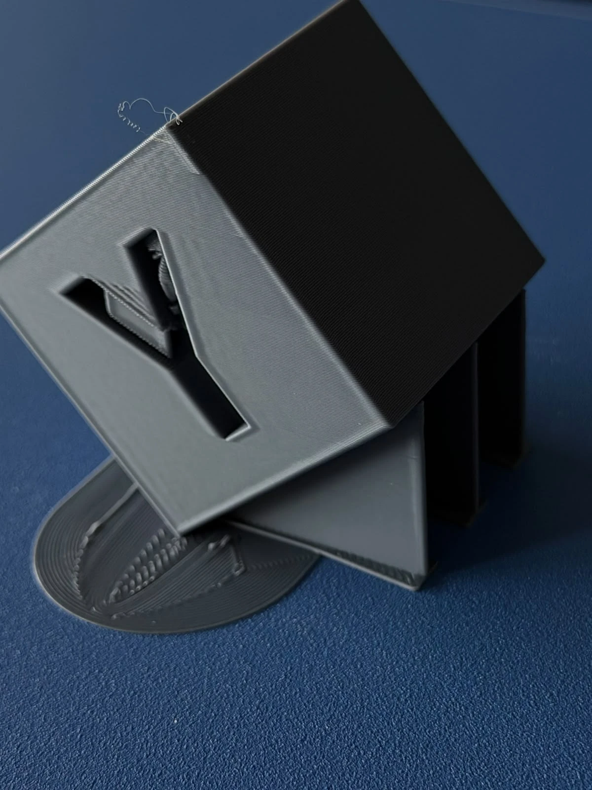
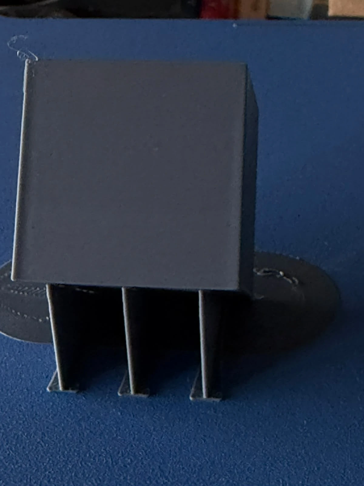
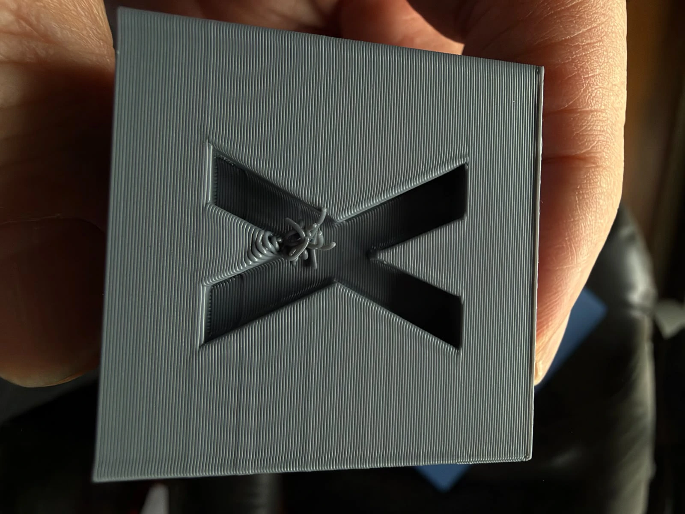
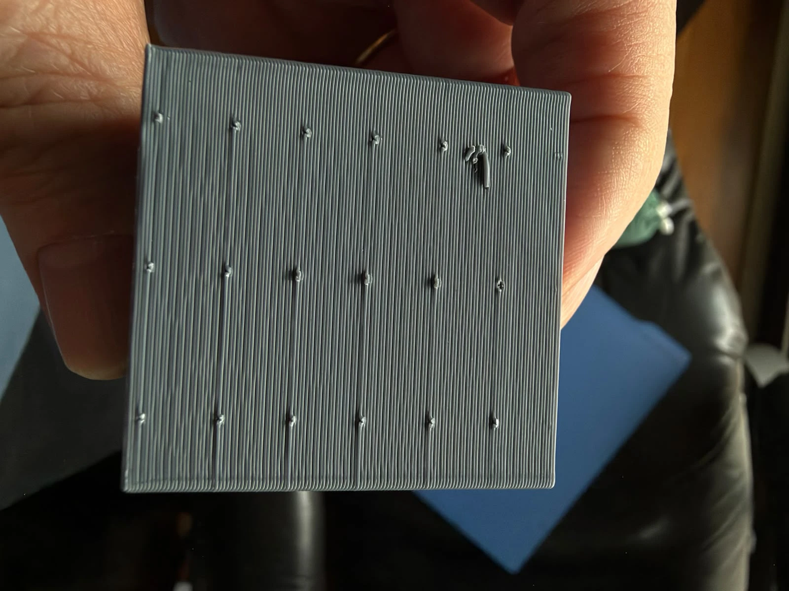
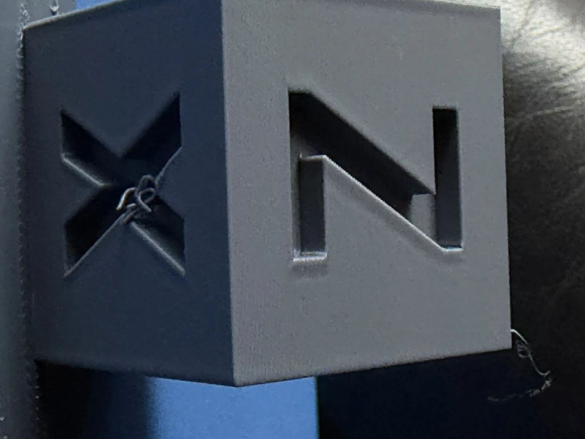
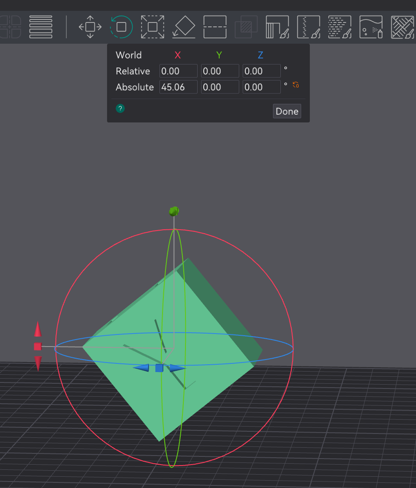
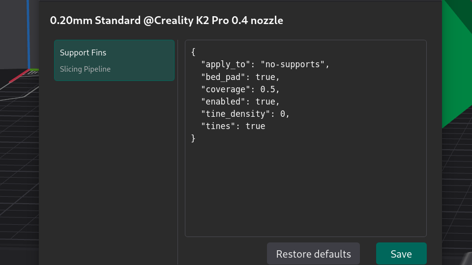
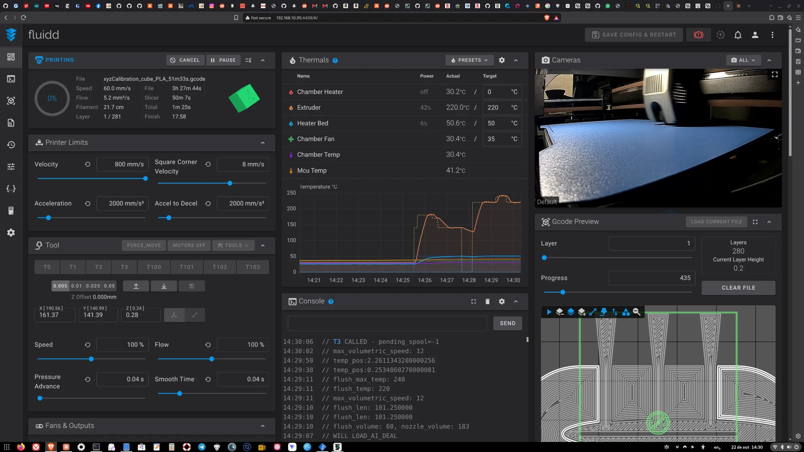
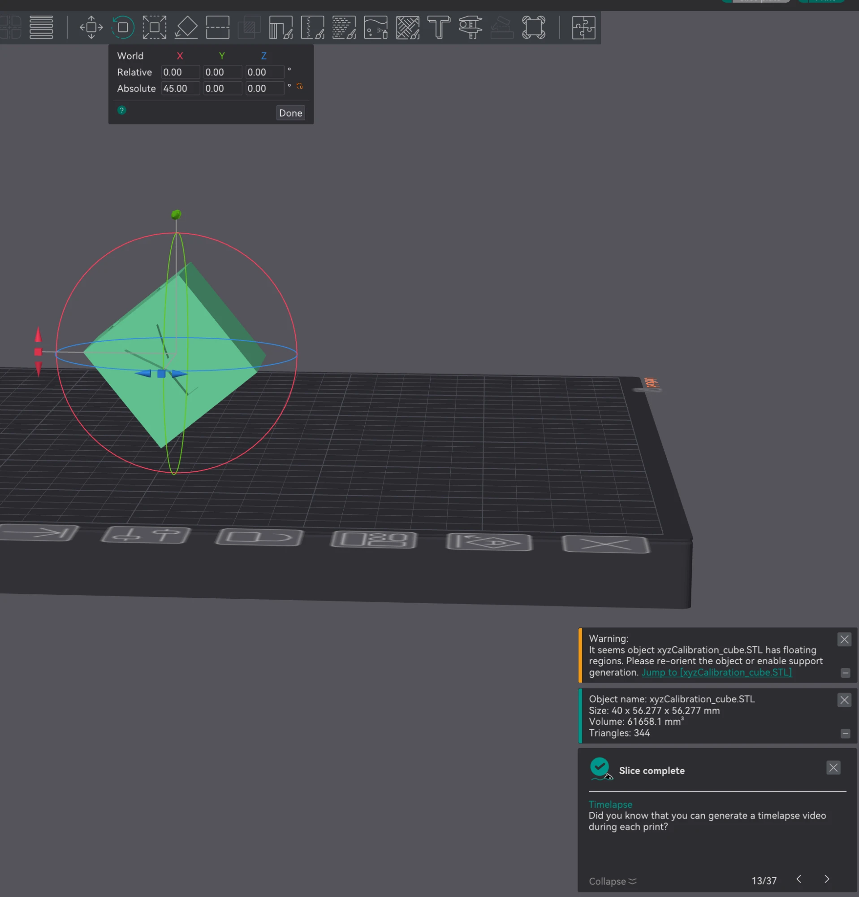
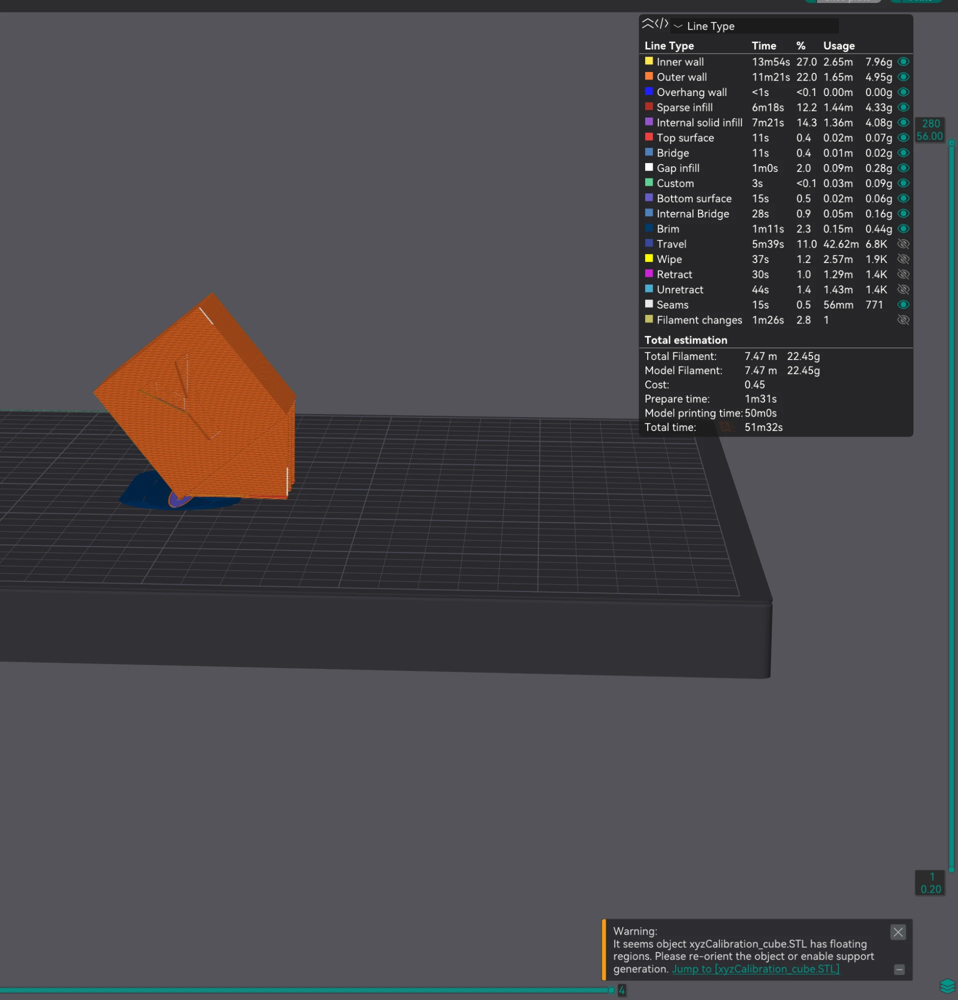

# Chapter 3: calibrated settings with plugin 0.7.759 (planned)

> Status: **in progress** (Linux). Read the [overview](00-Overview.md) (section *Plugin 0.7.759 and later*) first.

## Why

Chapters 1 and 2 showed the plugin works and is identical on Linux and macOS, but left scars on the
supported face, and plugin 0.1.0 could not take the calibration results. Upstream fixed that in
**0.7.759** after [gittrahan/support-fins#253](https://github.com/gittrahan/support-fins/issues/253): the
Config tab now accepts every engine option. The maintainer asked for two reports:

1. how the **calibrated settings** print;
2. **Full coverage** (`"mode": "full"`) on a part with **wide overhangs** (the newest code path).

## Plan, one variable at a time

| Step | What | Output |
|---|---|---|
| 0 | Install plugin 0.7.759 (`PLUGIN_FILE=plugins/support-fins/support_fins_orca-0.7.759.py scripts/install-support-fins.sh`); Orca's plugin list must show **0.7.759** | version + sha256 `0de0f02a…5c81` |
| 1 | Orca temperature tower for the PLA | best nozzle temperature |
| 2 | Orca Pressure Advance calibration → value into `printer.cfg`; *Enable pressure advance* off in every filament profile | PA value |
| 3 | Support Fins coupons, printed **without** the plugin (fins are in the files): `angle`, `gap`, `grip`, `pad` (guide: `docs/CALIBRATION.md` in support-fins) | `threshold`, `gap`, `tines`/`tineDensity`, `padStyle` |
| 4 | Re-slice the tilted `xyzCalibration_cube` (same `.3mf` as Chapters 1–2) with the calibrated config, e.g. `{"threshold": …, "gap": …, "tineDensity": …, "padStyle": "…"}` | compare the supported face with Chapters 1–2 |
| 5 | A part with **wide overhangs**, sliced with `"mode": "auto"` and then `"mode": "full"` | report for upstream |

Note the cube's bare overhang regions at 45°: they need a `threshold` **above** 45 (e.g. 46; see the
log of 22 Oct: a *lower* threshold supports *less*) or
`"mode": "full"` they should now get walls.

## Report back upstream

Post the results as a comment on [#253](https://github.com/gittrahan/support-fins/issues/253) (or a
*calibration result* issue for the coupons): printer, nozzle, filament, best rung of each coupon,
config used, and photos of the undersides.

## Log

### 2026-10-22: step 0, plugin 0.7.759 installed on Linux

- `PLUGIN_FILE=plugins/support-fins/support_fins_orca-0.7.759.py scripts/install-support-fins.sh`
- Installed in `/home/jglerner/.config/OrcaSlicer/orca_plugins/SupportFins/support_fins_orca.py`,
  **version 0.7.759**, sha256 `0de0f02ae34c1e46dd7f9456bae06385727b17473619fe0b52046f14ac8a5c81` ✅
  (matches the pinned copy).

### 2026-10-22 14:30: first print with 0.7.759, cube at 45°

- Fluidd: `xyzCalibration_cube_PLA_51m33s.gcode`, **280 layers** (×0.2 mm = 56 mm). Intended as the
  cube at 45°; the plugin log shows the actual pose (below).
  Slicer estimate 50 min 7 s. Nozzle 220 °C, bed 50 °C.
- First layer (Fluidd G-code preview): pad with brim and **3 fins with flared, tapered feet** (wider
  at the base), a different fin foot shape from 0.1.0's straight walls. First layers printing normally.

- Printer state at start: PA 0.04 / smooth time 0.04; acceleration 2000 mm/s², SCV 8 mm/s
  (first-layer limits).
- **Config used:** the old 0.1.0 config, saved with the process profile
  `0.20mm Standard @Creality K2 Pro 0.4 nozzle` and carried over unchanged:
  `{"apply_to": "no-supports", "bed_pad": true, "coverage": 0.5, "enabled": true, "tine_density": 0, "tines": true}`.
  In 0.7.759 these are accepted (`tine_density` and `bed_pad` are aliases) and equal the engine
  defaults, so this run is **case A: defaults (`mode` auto, `threshold` 45)**. Note: the Config is
  stored **per process profile**; *Restore defaults* would reset it to 0.7.759's
  `{"enabled": true, "apply_to": "no-supports"}`.
- **Plugin log (0.7.759 now writes `"version": "0.7.759"` in each entry):**

  | Field | Chapter 1–2 (0.1.0, ~26.4° pose) | This run (0.7.759) |
  |---|---|---|
  | `part_size_mm` | [40.0, 53.626, 53.626] | **[40.0, 56.282, 56.282]** |
  | `engine.overhangRegions` | 5 | 5 |
  | `engine.braces` (walls) | 4 | **5** |
  | `engine.tines` | 24 | 24 |
  | `engine.unserved` (too shallow, left bare) | 3 | **2** |
  | `engine.padTriangles` | 35,904 | 30,566 |
  | `engine.pins` | — | `false` (new field) |

- **Pose (Orca rotation panel): X = 45.06° absolute**, Y = 0, Z = 0. Typing 45 did not stick exactly.
  - ~~The bounding box is shorter because the cube's edges are bevelled~~ **Wrong, see the 3MF
    analysis below:** the mesh has sharp corners, and the bounding box means what it says (~39°).
  - At 45.06° the two bottom faces sit at **44.94°** and **45.06°** from horizontal. The 44.94° face is
    just past the default 45° threshold, so it **is** an overhang and gets fins. This run therefore
    does not prove the new engine changed the exact-45° behavior: the 0.06° offset alone explains it.
  - Orca's rotation field could not be set to 45.00°: the closest values were **44.96°/44.98°** and
    **45.06°** (it jumps over 45.00 with both typing and the step arrows). Both sides of 45 leave one
    bottom face just under 45° from horizontal, so both get fins.
- Pending: the rest of the log line (`result`, `layers_touched`), Orca Preview.

### 2026-10-22: exact 45° tested outside Orca (engine CLI)

Orca could not hold 45.00°, so the engine was run directly with the support-fins command-line
tool (same engine as the plugin), on a sharp 20 mm cube, at the angles Orca allowed and at
exactly 45°. Two builds: 0.7.771 (20 Oct, the first build after the 0.7.759 plugin release) and
0.7.814 (current `main`, 22 Oct). **Both gave identical results:**

| Rotation about X | defaults | `threshold` 44 | `threshold` 46 | `mode` full |
|---|---|---|---|---|
| 44.96° | 2 walls, 8 tines | **0** | 4 walls, 16 tines | 2 walls, 8 tines |
| **45.00°** | **0 walls** | 0 | **4 walls, 16 tines** | **0 walls** |
| 45.06° | 2 walls, 8 tines | **0** | 4 walls, 16 tines | 2 walls, 8 tines |

Findings:

1. **Exactly 45° still gets no fins with the defaults**, same as with 0.1.0: a face exactly on the
   threshold is not an overhang. The engine change did not alter that; the Orca run got fins only
   because Orca's rotation could not reach 45.00°.
2. **`threshold` is measured up from the plate and lower is stricter.** Faces *shallower* than the
   threshold get support, so **lowering it to 44 supports less** (0 walls here) and **raising it to 46
   supports the 45° faces** (4 walls). This is how `docs/CALIBRATION.md` defines it ("lower is
   harder"); the earlier suggestion in this chapter to use 44 was backwards and has been corrected.
3. **`"mode": "full"` does not help at exactly 45°.** Full coverage adds walls under overhangs that
   Auto leaves bare, but a face on the threshold is not an overhang in the first place, so there is
   nothing to cover.

Practical rule for this printer until `angle-coupon` is printed: for parts with 45° faces, use
`"threshold": 46` (or the calibrated value).

### 2026-10-22: exactly 45.00° reached in Orca, default config

- Rotation panel: **Absolute X = 45.00°**, Y = 0, Z = 0 (reached after several attempts). Object size
  40 × 56.277 × 56.277 mm, 344 triangles.
- Sliced (280 layers, 50 min 0 s model time, 22.45 g, 7.47 m). Preview at full height (screenshot 5): **no fins visible** (they are hidden under the cube; the log later showed 5 walls);
  only the bottom edge on the bed with brim (`Brim` 1 min 11 s, 0.44 g). Orca shows its usual
  *"floating regions"* warning.
- This **matches the engine CLI prediction**: at exactly 45° the faces sit on the threshold and get no
  fins with the defaults. Pending: the plugin log line, to confirm `0 walls`.

### 2026-10-22 14:47–15:10: same result at 44.98°, 45.00° and with `threshold` 46

Plugin log, last three slices (time, `part_size_mm`, result):

| Time | Pose | Config | Result |
|---|---|---|---|
| 14:47:37 | 44.98° (56.2735 mm) | defaults | 5 walls, 24 tines; 2 overhangs too shallow |
| 14:53:16 | 45.00° (56.277 mm) | defaults | 5 walls, 24 tines; 2 overhangs too shallow |
| 15:07:17 | 45.00° (56.277 mm) | `"threshold": 46` (+ gyroid infill) | 5 walls, 24 tines; 2 overhangs too shallow |

- Orca stores the plugin Config **in the process preset** and re-sorts the keys alphabetically. After
  editing it shows *"Configuration updated. Save the preset to persist it."*
- The log (0.7.759) does **not** record the config the slice used, so a deliberate invalid value was
  used to check that edits reach the plugin: `"threshold": 99` (allowed range 30–70).
  - Result: the slice failed with **Orca's** *"One object has an empty first layer and can't be printed"*.
    That means the plugin ran, refused the config and added nothing (no pad), so the cube's edge alone
    left the first layer empty. **The edit does reach the plugin.**
  - Confirmed in the plugin log: `"error": "ValueError: threshold must be 30..70, got 99"`.
  - The plugin's own message about `threshold` was **masked** by Orca's empty-first-layer error. Worth
    reporting upstream: with a bad config on a part that relies on the pad, the user never sees why.
- Open question: why `threshold` 46 changes nothing on this cube when the engine CLI (sharp cube, no
  letters) goes from 0 to 4 walls. Hypotheses: (a) the 5 regions are mostly the recessed **X/Y/Z
  letters** (their ceilings are small overhangs), not the big faces; (b) Orca's "45.00°" is rounded
  for display, so the faces were already just past 45° and got walls at the default.

### 2026-10-22 15:14: Preview at layer 25 (5.00 mm), 45.00°, `threshold` 46

- Top/side view at layer 25: the cube's cross-section near its bottom edge, the pad with brim, and
  **3 parallel walls extending from one side only**, i.e. under **one** of the two big 45° faces.
  No walls under the other big face at this height.
- So hypothesis (a) (only letter recesses) is ruled out: one big face **is** supported. That face was
  already supported with the defaults (same counts), which fits hypothesis (b): Orca's "45.00°" leaves
  that face a hair past 45°.
- The second big face is not supported even with `threshold` 46, and the counts did not change
  (5 walls, 2 "too shallow"). Possibly that face is detected but reported as *too shallow for a fin
  this way up* (one of the 2 unserved). Next checks: `threshold` 50 and `"mode": "full"` at the same pose.

### 2026-10-22 15:17: `threshold` 50 changes nothing either

| Time | Pose | Config | Plugin log |
|---|---|---|---|
| 14:53:16 | 45.00° | defaults (threshold 45) | 5 walls, 24 tines; 2 too shallow |
| 15:10:58 | 45.00° | `threshold` 99 | `ValueError: threshold must be 30..70, got 99` |
| 15:14:25 | 45.00° | `threshold` 46 | 5 walls, 24 tines; 2 too shallow |
| 15:17:28 | 45.00° | `threshold` 50 | 5 walls, 24 tines; 2 too shallow |

- Every run is a fresh plugin execution (new log line), and the plugin code (`engine_options` →
  `host_options`) passes `threshold` to the engine unchanged. So the engine **receives** 46 and 50
  and still returns the same walls: on this cube (bevelled edges, recessed X/Y/Z letters) raising
  the threshold does not reach the second big face, unlike the sharp test cube in the CLI.
- Preview at layer 25 (top view) is identical in all three: 3 walls on one side of the bottom edge only.
- Next: run the exact part through the engine CLI (project `.3mf` to be added to `projects/`) to see
  which 5 regions the engine finds and why the 2 are "too shallow", then report upstream with the file.

### 2026-10-22: the saved project shows the real angle is 39.18°, not 45°

The project was saved from Orca with the rotation panel showing **Absolute X = 45.00°** and sent as
`projects/xyzCalibration_cube-orca45.3mf`. Inside the 3MF:

- Mesh: the 20 mm `xyzCalibration_cube.STL` (344 triangles, bounding box exactly ±10 mm, so sharp
  corners), scaled ×2 → 40 mm. Saved settings: `sparse_infill_density` 6 %, `brim_width` 5,
  `enable_support` 0.
- Build transform: `2 0 0 0 1.55032176 1.26352778 0 -1.26352778 1.55032176 …` → uniform scale 2.000 and
  a rotation about X of **atan2(1.2635, 1.5503) = 39.18°**.
- A 40 mm cube at 39.18° has a 40·(cos + sin) = **56.277 mm** bounding box, exactly what Orca's object
  info showed. A true 45° would be 56.569 mm.

**So Orca's rotation panel said 45.00° while the object was actually at 39.18°.** The earlier
"bevelled edges" explanation was wrong; the first bounding-box estimate (~39°) was right. Why Orca's
*Absolute* field disagrees with the stored transform is not known yet (to check: set Absolute X to 0
and see whether the object info reads 40 × 40 × 40).

#### The exact part through the engine CLI (0.7.771, same engine as 0.7.759)

Mesh extracted from the 3MF, scaled ×2, rotated about X:

| Rotation | defaults | `threshold` 46 | `threshold` 50 | `threshold` 52 | `mode` full |
|---|---|---|---|---|---|
| **39.18°** (what Orca really used) | **5 walls, 24 tines; 2 too shallow** | 5 / 24 | 5 / 24 | **7 walls, 32 tines** | **13 walls, 59 tines** |
| 45.00° (true) | 1 wall, 3 tines | 11 walls, 49 tines; 3 too shallow | 11 / 49 | 11 / 49 | 2 walls, 5 tines |

- The 39.18° defaults row **reproduces Orca's plugin log exactly** (5 walls, 24 tines, 5 regions, 2 too shallow).
- At 39.18° the two big bottom faces are at **39.18°** (an overhang, gets the 3 visible walls) and
  **50.82°** from horizontal. `threshold` 46 and 50 are both below 50.82, so nothing changes; **52**
  is the first value tested that reaches the second face (7 walls). This explains the identical
  results of 15:14 and 15:17.
- **Full coverage** at 39.18° adds the most walls (13), the newest code path the maintainer asked about.
- At a **true** 45° the engine behaves as expected: defaults give 1 small wall (letter recesses),
  `threshold` 46 gives 11 walls under both faces.

Conclusions so far:
1. The plugin and the engine behave correctly and consistently; the confusion came from Orca's
   rotation display.
2. `threshold` direction confirmed on the real part: higher = more support.
3. Next in Orca: same pose with `"threshold": 52`, then `"mode": "full"`; and investigate the rotation display.

### 2026-10-22: printed result, plugin 0.7.759, cube at 39.18° (Orca showed "45.06°"), defaults

Print of `xyzCalibration_cube_PLA_51m33s.gcode` (started 14:30). Six photos:

- **Fins:** 3 parallel walls under the lower big face, each with a **flared "T" foot** on the bed
  (0.1.0 had plain walls). A triangular wedge joins the cube's bottom edge to the oval pad. Inside the
  **Y** recess a small wall is visible: the letter-ceiling support (one of the 5 walls in the log).
- **Removal:** the fins "fell off practically into the hand" (J. Lerner), easier than with 0.1.0.
- **Supported face (after removal):** **flat, regular layer lines**, no drooping or torn patches. What is
  left: a neat grid of **small dots** (3 rows × 6, the tine contact points) and faint straight lines
  where each wall touched, plus one small burr. With 0.1.0 the same face was wavy, drooping between
  the walls and torn in places.
- **Free faces (X, Y, Z):** clean, sharp letters. A tangle of strings in the centre of the **X**
  recess (stringing / the letter-recess support), cosmetic.
- **Pad:** the oval pad's top surface is rough (dimpled), as before; irrelevant, it is sacrificial.
- **Removed support (6th photo):** it came off in **a few pieces** rather than one: the pad split
  open into a "J"-shaped strip, the walls with their feet and the wedge stayed together, and one
  wall/wedge section with its foot came away separately. With 0.1.0 fins, wedges and pad came off as
  a single piece. Easier removal, at the cost of more loose pieces to collect from the bed.

**Caveat for the comparison:** two things changed at once. The engine (0.1.0 → 0.7.759, flared feet,
tines) **and** the pose: the supported face now sits at **39.18°** from horizontal, a milder overhang
than the **~26°** face in Chapters 1–2. Part of the improvement may come from the pose. A fair
engine-only comparison would print the Chapter 1 pose with 0.7.759.

Photos (defaults print):

| | |
|---|---|
|  | On the bed, Y side: walls under the lower face, pad on the bed, a small wall visible in the Y recess |
|  | The 3 walls with flared "T" feet |
|  | X face: clean, a tangle of stringing in the letter recess |
|  | Lower (supported) face after removal: flat, 3 rows × 6–7 tine dots, faint lines where the walls touched, one burr |
|  | X and Z faces: clean |

### 2026-10-22 16:03: same project (39.18°), `"threshold": 52`

- Orca estimate changed for the first time in this series: **50 min 42 s, 22.47 g, 7.47 m**
  (vs 49 min 54 s, 22.22 g with 45/46/50), so the fins changed.
- Preview, layer 25 (5.00 mm), top and side views: **4 walls** on the same side of the bottom edge
  (3 before); still nothing visible on the other side at this height.
- Plugin log 16:02:34, `part_size_mm` [40.0, 56.277, 56.277]: **7 walls, 32 tines; 2 overhangs are too
  shallow** ✅, **exactly the engine CLI prediction** (7 walls, 32 tines). The Orca plugin and the
  standalone engine agree on the real part.
- **Printing** this slice (`threshold` 52, 7 walls, 32 tines; estimate 50 min 42 s, 22.47 g) on 22 Oct
  after 16:03. Same pose (39.18°), so it isolates the effect of the extra walls compared with the
  defaults print above. Result (5 photos):
  - **4 parallel walls** with flared "T" feet under the lower face (3 in the defaults print), on the
    oval pad. The cube stands on its edge with the wedge on the other side.
  - Free faces **X** and **Z** clean, letters sharp; again a small tangle of strings in the **X** recess.
  - During removal the walls came away together with the pad, which opened into a loop; the walls
    taper to a thin edge at the part (tine side).
  - **Supported face:** flat, regular layer lines, the same neat **grid of small dots** (3 rows × 6)
    as the defaults print, plus a couple of short strings at the edges. **No visible difference** in
    surface quality from the defaults print: the extra walls did not change the finish of this face.
  - **Removal: very easy** (J. Lerner), like the defaults print.
  - Conclusion: on this part and pose the extra walls of `threshold` 52 cost +0.25 g and +48 s with no
    visible gain; the defaults were already enough.

### 2026-10-22 21:06: same project (39.18°), `"mode": "full"` (sliced)

- Config: `"mode": "full"` (no `threshold`, so 45). 280 layers.
- Orca estimate: **59 min 39 s total (58 min 7 s model), 25.36 g, 8.44 m**, vs 49 min 54 s / 22.22 g
  with the defaults: **+3.14 g, about +9 min 45 s**, the largest change in the series.
- Preview, layer 25 (5.00 mm): a dense row of parallel walls under the lower big face (about
  **ten**, vs 3 with the defaults) plus a separate group of walls on the opposite side, under the
  second face that Auto left bare. Full view (layer 280): fins hidden under the cube, brim on both sides.
  Orca still shows its usual *"floating regions"* warning.
- Plugin log 21:04:29 (object 85), `part_size_mm` [40.0, 56.277, 56.277]: **13 walls, 59 tines; 2
  overhangs are too shallow for a fin this way up**. Engine: 5 overhang regions, 13 braces,
  6640 fin triangles (vs 2704 with defaults), `unserved` 2, 213 layers touched, 3.37 s.
  **Exactly the engine CLI prediction.** First-layer fin area 1473.6 mm² (vs 696.0 with defaults).
- **Printed** (photos sent 23 Oct, before removal and during removal):
  - Under the lower big face: **6 parallel walls** with flared feet on the pad (vs 3 with the defaults).
  - Under the **second big face** (50.82°, never supported by Auto): a solid triangular wall that
    follows the face, plus a block-shaped wall under the edge on the Z side. Full coverage does what
    it says: both big faces are now supported.
  - Pad on the bed on both sides; small whiskers of stringing along one cube edge.
  - Removal: the walls came away **together with the pad**, which bent and tore around the edges
    (same behaviour as with `threshold` 52).
  - After removal (photos 23 Oct): the whole support (walls, triangular wall, pad) came off as
    **one piece**.
  - The plain (lower) face: **flat**, but with a dense grid of tine marks, about **7 rows of 4–5 small hooked
    burrs** (vs the 3 × 6 dot grid with the defaults), plus a slight ridge along each row. Noticeably
    more marks than the defaults, no drooping.
  - The **X** face: clean, except **one row of 5 small burrs** across the middle and a few in the
    letter recess.
  - Tester: the plain face is the **lower** bottom face (the one Auto already supported with 3 walls);
    removal **easy, same as the defaults**.

## Screenshots (Linux, 22 Oct 2026)

| | |
|---|---|
|  | 1. Rotation panel at *Absolute X 45.06°*: Orca would not hold 45.00 at first |
|  | 2. Plugin Config in 0.7.759, still showing the 0.1.0 keys (`bed_pad`, `tine_density`), which 0.7.759 accepts as aliases |
|  | 3. Fluidd, 14:30: first 0.7.759 print starting (`xyzCalibration_cube_PLA_51m33s.gcode`, 280 layers); G-code preview of layer 1 shows the pad and the flared fin feet |
|  | 4. *Absolute X 45.00°* finally reached, yet the object size is 40 × 56.277 × 56.277 mm, i.e. a **39.18°** rotation (see the 3MF analysis) |
|  | 5. Preview, full height (layer 280), defaults: 22.45 g, 50 min 0 s. The fins sit under the cube and cannot be seen at full height; the plugin log for this pose shows 5 walls (14:53:16), so the earlier note "no fins under the cube" came from this view, not from the slice |

## Status on 23 Oct 2026 (summary)

| # | Test (plugin 0.7.759, project `projects/xyzCalibration_cube-orca45.3mf`, real pose 39.18°) | Result |
|---|---|---|
| 1 | Defaults (threshold 45), printed | 5 walls, 24 tines; fins with flared "T" feet; **fell off practically by hand**; supported face **flat** with a neat 3 × 6 dot grid (much better than 0.1.0, with the pose caveat) |
| 2 | `threshold` 46 / 50 / 52 sliced; 52 printed | 46 and 50 identical to defaults (second face at 50.82° not reached); **52 → 7 walls, 32 tines**, exactly the engine CLI prediction; printed finish same as defaults, removal very easy |
| 3 | `threshold` 99 (invalid) | engine refuses it (`threshold must be 30..70, got 99`) but Orca only shows *"empty first layer"*: the plugin's message is masked |
| 4 | `"mode": "full"`, printed | **13 walls, 59 tines**, exactly the CLI prediction; 25.36 g, 59 min 39 s (+3.14 g, ~+10 min); walls under **both** big faces; removal easy, same as defaults; lower face flat but with a denser grid of tine burrs (~7 rows) |

Side finding (Orca, not the plugin): the rotation panel showed *Absolute X 45.00°* while the saved
transform is 39.18°.

All four tests done. Follow-up posted (23 Oct) on
[#253](https://github.com/gittrahan/support-fins/issues/253) (draft: [issue-253-followup-draft.md](issue-253-followup-draft.md)).
