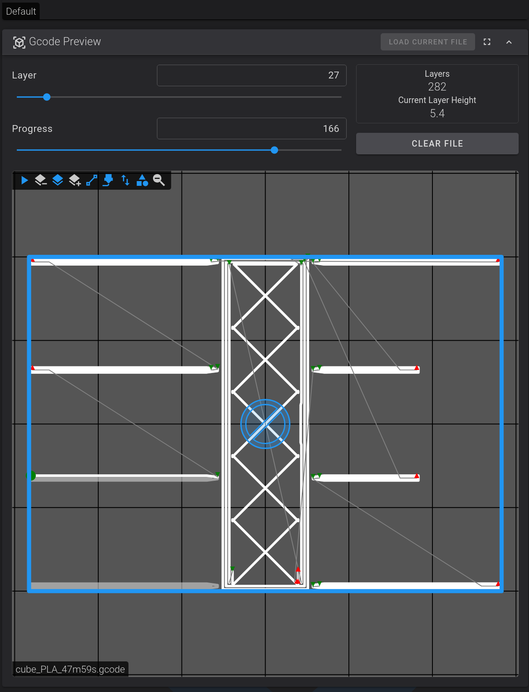
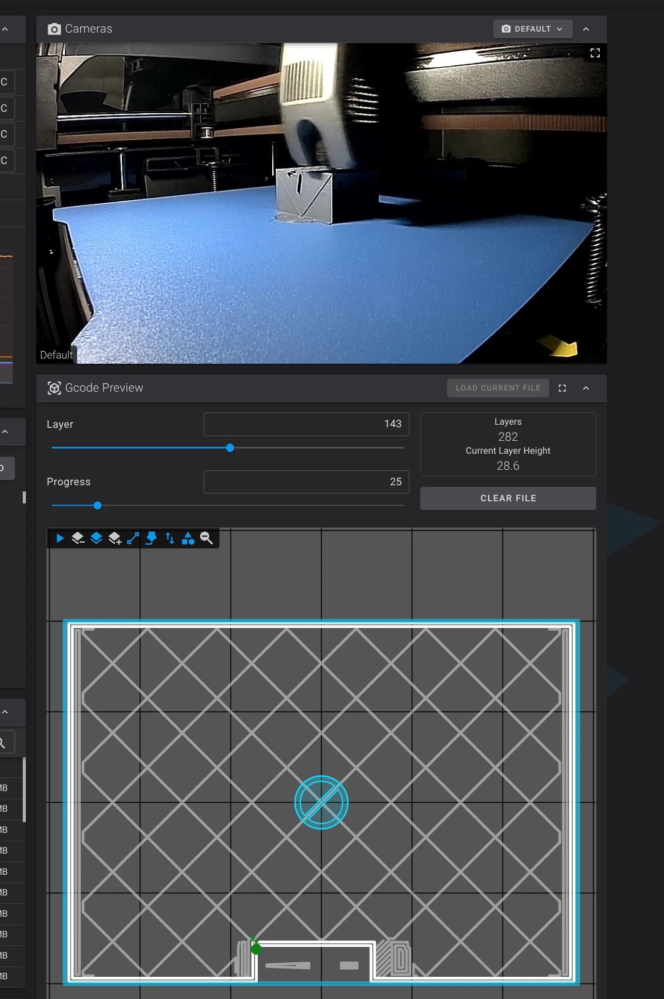
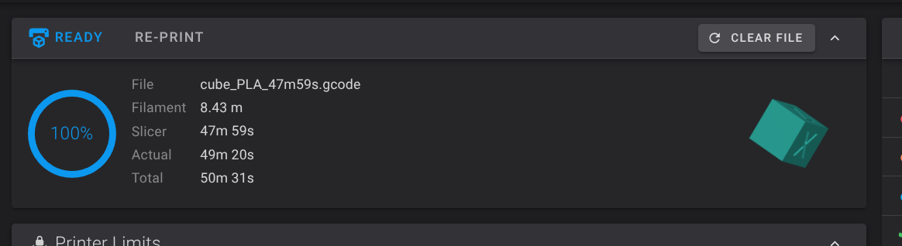
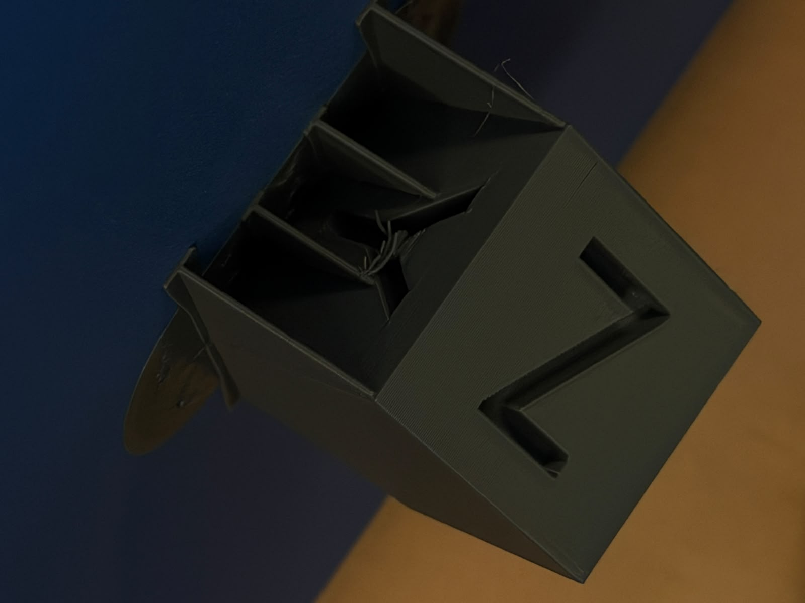
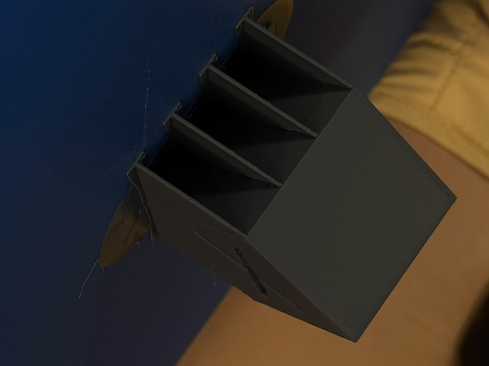
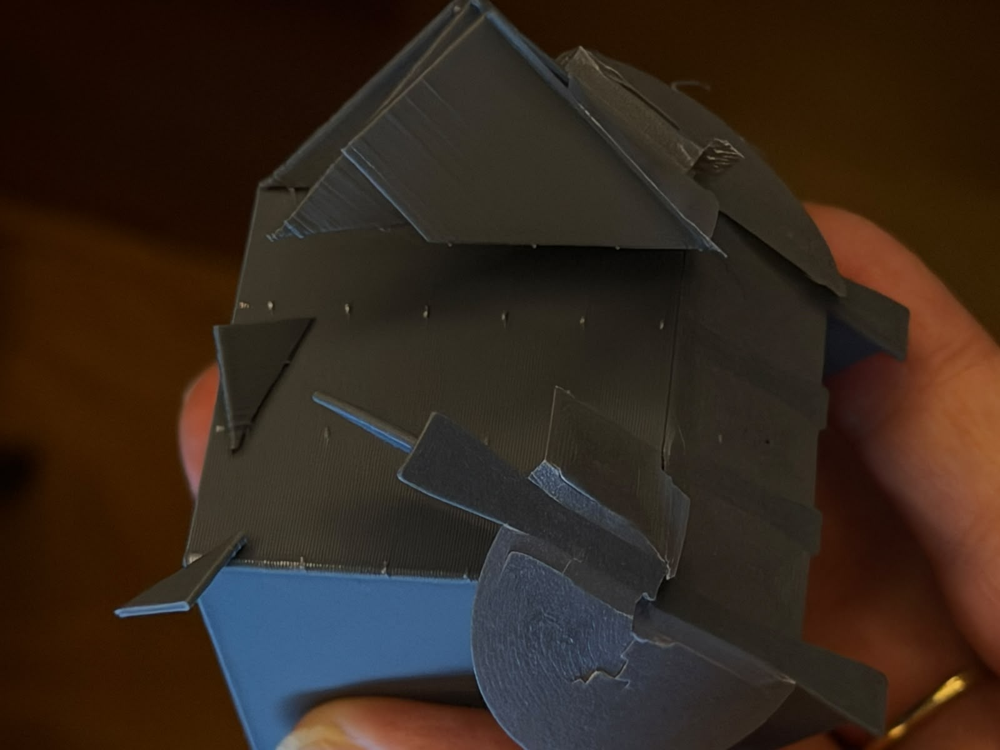
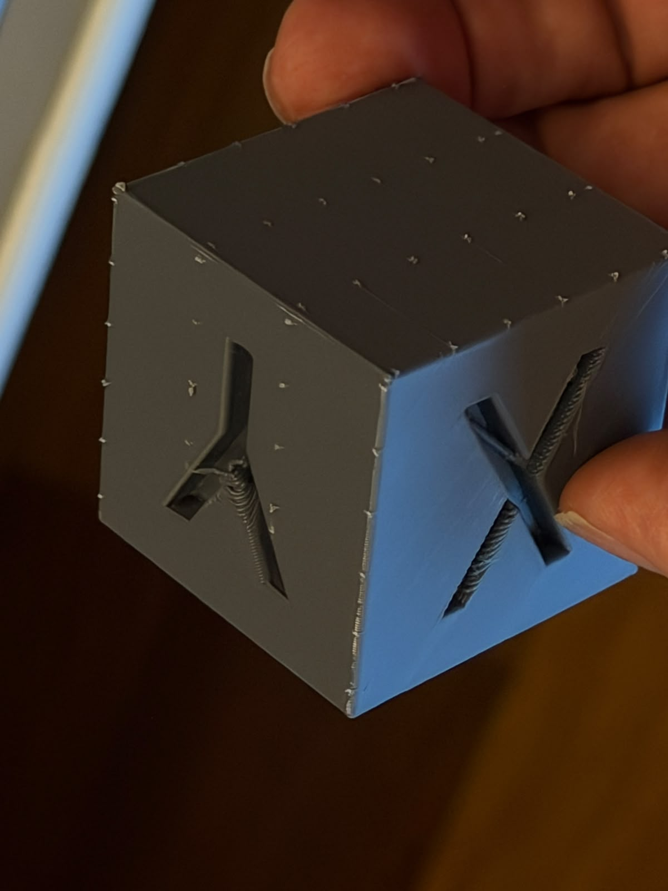
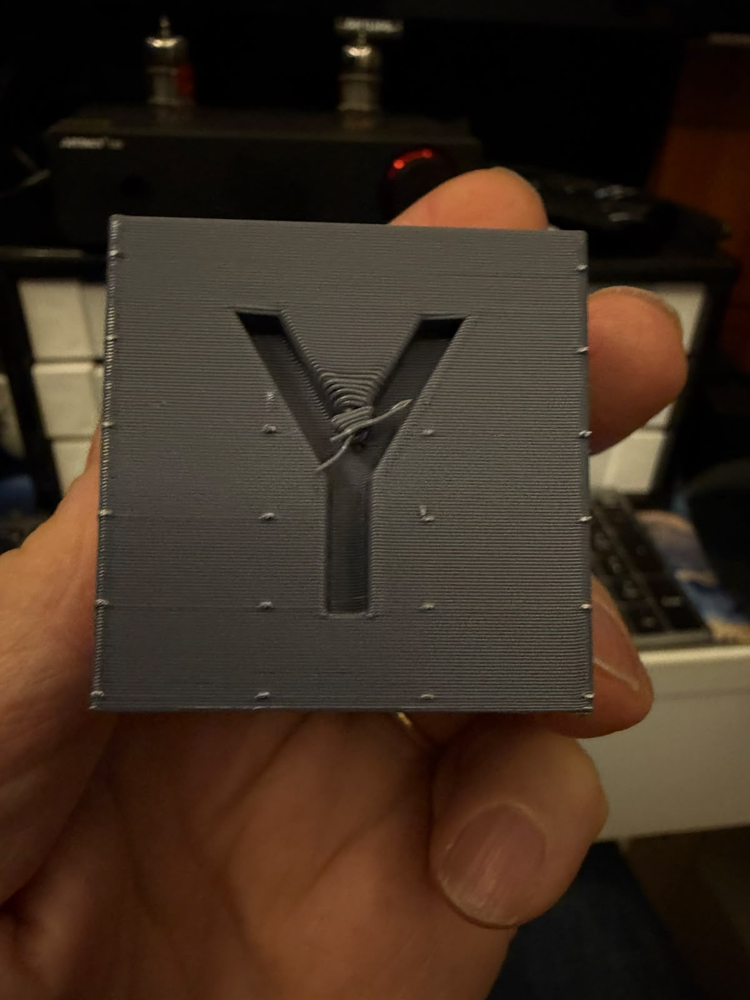
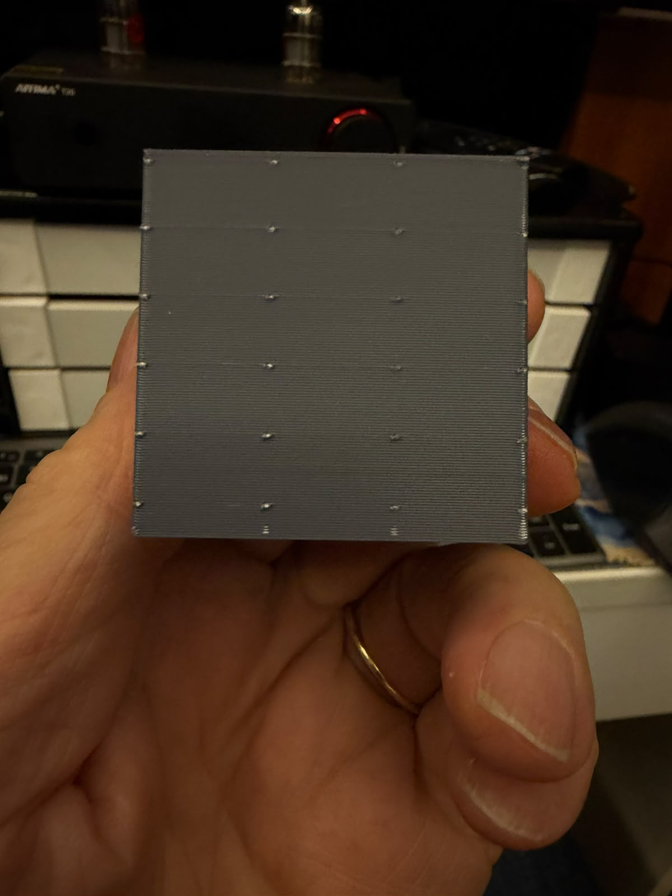

# Chapter 4: OrcaSlicer 2.5 stable (Flatpak) with plugin 0.7.987

## Why

OrcaSlicer **2.5** is now a stable release, so the plugin system no longer needs a nightly. This
chapter checks that Support Fins runs the same on the stable release, with the newer plugin
**0.7.987**, and compares it with Chapter 3 (nightly 2.5.0-dev + plugin 0.7.759) on the same part.

## Test environment

| Item | Value |
|---|---|
| Machine | Debian 13 (x86_64), the same as Chapters 1 and 3 |
| OrcaSlicer | **2.5 stable, Flatpak from Flathub** (`com.orcaslicer.OrcaSlicer`) |
| Configuration folder (`data_dir`) | `~/.var/app/com.orcaslicer.OrcaSlicer/config/OrcaSlicer` (**not** `~/.config/OrcaSlicer`) |
| Plugin | Support Fins **0.7.987**, sha256 `acd8444af1c23df22ed3cea96829513dadb872b9b68f4718c1b2ca3e1551bbfc`, pinned in `plugins/support-fins/support_fins_orca-0.7.987.py` |
| Printer / process | Creality K2 Pro 0.4 nozzle, `0.20mm Standard @Creality K2 Pro 0.4 nozzle`, Generic PLA |

## Log

### 2026-11-09: installing 0.7.987 on the Flatpak Orca

- 15:28: J. Lerner downloaded `support_fins_orca.py` by hand. It turned out to be **0.7.977**
  (sha256 `84a325600a271cb1…`): `plugins-latest` was rebuilt shortly afterwards.
- 15:39–15:40: `scripts/install-support-fins.sh` (no `PLUGIN_FILE`) downloaded **0.7.987** and
  installed it into `~/.config/OrcaSlicer`, the nightly's folder.
- Orca 2.5's *Plugins* window showed **"No plugins found"**. *Help ▸ Show Configuration Folder*
  opened `~/.var/app/com.orcaslicer.OrcaSlicer/config/OrcaSlicer`: the stable release is the
  **Flatpak**, which keeps its configuration inside the sandbox and never reads `~/.config/OrcaSlicer`.
  Its `orca_plugins` folder was empty.
- Fix: install again with `ORCA_DATA_DIR`:
  ```bash
  ORCA_DATA_DIR=~/.var/app/com.orcaslicer.OrcaSlicer/config/OrcaSlicer \
  PLUGIN_FILE=plugins/support-fins/support_fins_orca-0.7.987.py \
  scripts/install-support-fins.sh
  ```
  The install script now warns when a Flatpak configuration exists and prints this variable.
- Result: *Plugins* window lists **Support Fins 0.7.987**, Source *Local*, Status **Activated**,
  author "Matthew Trahan (engine), J (Orca plugin)".
- Process profile `0.20mm Standard @Creality K2 Pro 0.4 nozzle`: Support Fins already listed under
  *Slicing Pipeline Plugin*; Config `{"apply_to": "no-supports", "enabled": true}` (defaults).

### 2026-11-09: first slice, new cube at exactly 45°, defaults

- The tester rotated a fresh copy of the XYZ calibration cube, saved as `cube.stl` (the same 20 mm
  XYZ cube with recessed X/Y/Z letters, scaled to 40 mm; not the Chapter 3 project file). Orca's rotation panel
  showed **World, Absolute Y = 51.77°**, but the plugin log gives `part_size_mm` **[56.5685, 40.0,
  56.5685]**, i.e. 40·√2: the cube rests on an edge at **exactly 45°** about Y. The rotation panel
  again does not show the real pose (see Chapter 3, 45.00° vs 39.18°).
- Preview at full height looked fin-less: the fins (if any) sit under the cube. At layer 28 (5.60 mm)
  only the pad, the brim and the cube's lowest section are visible.
- Orca estimate: 21.45 g, 7.19 m, 36 min 13 s model time (37 min 39 s total).
- Plugin log: `"version": "0.7.987"`, result **"2 walls, 0 tines"**. Orca showed no
  *floating regions* warning.
- Reading: at exactly 45° both big bottom faces sit **on** the default 45° threshold, so they are not
  overhangs and get no fins (same as Chapter 3's CLI result). The 2 small walls without tines are most
  likely under the letter recesses. To support the 45° faces use `"threshold": 46`.

### 2026-11-09: same pose, `"threshold": 46`

- Config `{"apply_to": "no-supports", "enabled": true, "threshold": 46}`. Same part as above
  (`cube.stl`, the 20 mm XYZ cube scaled to 40 mm).
- Preview at layer 28 (5.60 mm): **walls under both big bottom faces**, with flared feet on the pad
  and brim around it.
- Orca estimate: **24.71 g, 8.29 m, 46 min 32 s model time (47 min 59 s total)**, vs 21.45 g /
  36 min 13 s with the defaults (+3.26 g, about +10 min).
- Orca shows only the yellow *"floating regions"* **warning** (its own support checker, which cannot see
  the fins; harmless, present in every print of Chapters 1–3). No error.
- Plugin log: `"version": "0.7.987"`, `part_size_mm` [56.5685, 40.0, 56.5685], result **"10 walls,
  44 tines; 2 overhangs are too shallow for a fin this way up (tilt the part steeper)"**, vs "2 walls,
  0 tines" with the defaults at the same pose. `threshold` 46 brings both 45° faces in.

### 2026-11-09: printing (`threshold` 46)

- Fluidd: `cube_PLA_47m59s.gcode`, **282 layers**.
- G-code preview at layer 27 (5.4 mm), seen from above: the cube's section is the narrow strip in the
  middle (the bottom edge, with diamond infill). The fins are **thin single walls perpendicular to
  that edge, on both sides** (both 45° faces now supported), 4 per side at this height, in pairs of
  different lengths. Each wall **tapers to a point where it meets the part**: the narrow tip is the
  contact that makes the fin break away cleanly.

  

- About half height, layer 143/282 (28.6 mm): the cube at its widest section (the 45° edges are at
  this height), sparse diamond infill, and a letter recess on one side with small support walls inside
  it (the "2 walls" of the default run). No fins outside the part any more: the two supported faces end
  here. Camera: print standing, no issues.

  

### 2026-11-09 17:5x: print finished

| | Orca estimate | Fluidd | Reading |
|---|---|---|---|
| Time | 47 min 59 s | **Actual 49 min 20 s**, Total 50 min 31 s | +1 min 21 s printing; Total adds heating and purge |
| Filament | 8.29 m, 24.71 g | **8.43 m**, about 25 g (J. Lerner) | +0.14 m, the CFS purge |

Mid-print (74 %, layer 159/283) Fluidd projected ~2.5 min less than Orca; as in Chapter 1, the small
top layers (minimum layer time) took the lead back.

| | |
|---|---|
|  | Fluidd at the end: 100 %, Actual 49 min 20 s, 8.43 m |
|  | On the bed, Z side: walls under one 45° face, pad below; some stringing in the cavity |
|  | On the bed, other side: walls under the second 45° face (both faces supported) |
|  | Removal in progress: walls and pad coming away in pieces; one supported face shows a row of tine marks |
|  | After removal: both supported faces flat, with scattered small tine burrs; stringing/support in the Y and X letter recesses |

Close-ups of the two supported faces (both at 45°):

| | |
|---|---|
|  | **Y face:** flat, regular layer lines; small tine burrs in rows along the edges and beside the letter. The only flaw is **inside the Y recess**: a few drooping layers in the air under the letter's ceiling (a small overhang the 2 letter walls did not fully hold) |
|  | **Plain face:** flat, regular layer lines, a grid of small tine burrs (4 columns × 7 rows), nothing else |

- **Removal:** no difficulty at all; apart from the visible tine dots, the support layer did not
  fuse to the part.
- **Burrs:** "do not even need a fingernail: just bend them and they break off" (J. Lerner).
- **J. Lerner's assessment:** **significant improvement on the supported faces**, apart from the few
  layers hanging in the air inside the Y.

## Result

OrcaSlicer **2.5 stable (Flatpak)** runs Support Fins **0.7.987** without changes to the plugin; the
only catch was installing into the Flatpak's own configuration folder. On a cube resting on an edge at
exactly 45°, `"threshold": 46` supports **both** 45° faces (10 walls, 44 tines vs 2 walls, 0 tines with
the defaults); the print costs about +3.3 g and +10 min and both faces come out flat, with tine burrs
that snap off by hand.

No upstream comment for this chapter (J. Lerner's decision): the test was better in every respect, so
the project is moving in the right direction and needs no report from us.

## Plan

1. Save the plugin Config and the process preset.
2. Open `projects/xyzCalibration_cube-orca45.3mf` (real pose 39.18°, see Chapter 3), check the plugin
   is still attached after the project's settings load, slice with the defaults.
3. Compare with Chapter 3 (0.7.759, defaults): **5 walls, 24 tines**, 22.22 g, 49 min 54 s.
